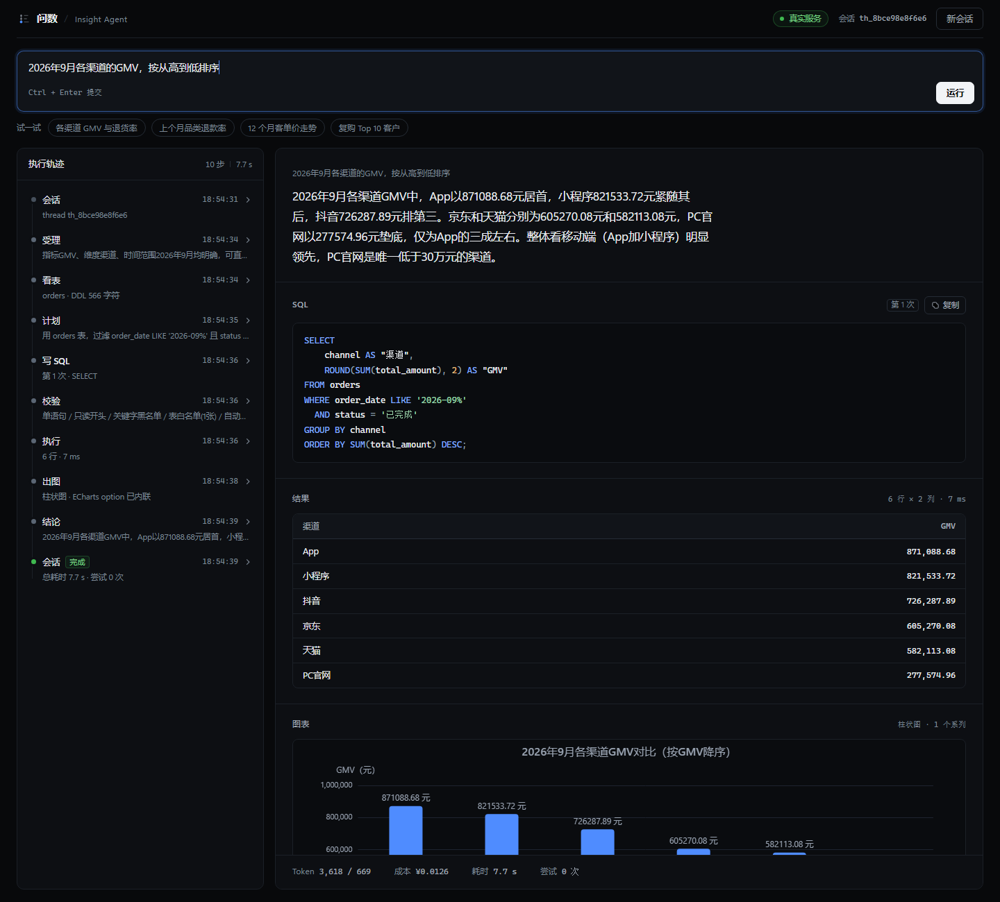

# 问数 Insight Agent

> 用中文问数据，它自己看表结构、写 SQL、跑、报错自己改，最后出图给结论。
>
> **自然语言 → SQLite → ECharts** 的完整链路，带只读沙箱、错误自修复、中断审批和 52 题评测集。

```
"2026年9月各渠道的GMV，按从高到低排序"
        │
        ▼
┌──────────────────────────────────────────────────────────┐
│ intake 分诊 → explore 选表 → plan 计划 → gen_sql 写SQL    │
│      → guard 校验 → execute 执行 ──错误──→ repair 重写    │
│      → visualize 出图 → summarize 结论                    │
└──────────────────────────────────────────────────────────┘
        │
        ▼
  App 871,088.68 · 小程序 821,533.72 · 抖音 726,287.89 …
  + 柱状图 + 一段带数字的结论（¥0.015 / 7.7s）
```



## 它能做什么

- **业务问题直接问**：销售、退货率、客单价、同比环比、品类排名、投放 ROI、复购
- **多轮追问**：问完「各渠道 GMV」再问「那只看抖音呢」，不用重复条件
- **口径不明会反问**：说「看看活跃用户」它会先问「活跃按登录还是按下单算」
- **危险请求会拒绝**：「把订单全删了」直接挡掉，不进 SQL 生成

## 三个和普通 demo 的差别

| | 普通 Text-to-SQL demo | 本项目 |
|---|---|---|
| 安全 | 模型生成的 SQL 直接执行 | **三层只读沙箱**：词法静态校验 → 只读连接 + `query_only` → 超时/行数熔断 |
| 容错 | 报错就失败 | **错误回灌自修复**：把数据库原始报错喂回去重写，最多 3 次 |
| 证明 | 「跑通了」 | **52 题评测集 + A/B 对照**：执行准确率、平均尝试次数、token、成本、P50/P95 延迟 |

## 快速开始

```bash
# 0. 依赖（Python 3.11+）
pip install -r requirements.txt

# 1. 配置密钥
cp .env.example .env        # 填 DEEPSEEK_API_KEY

# 2. 造示例库 + 自检
python -m insight initdb
python -m insight doctor

# 3. 问一个问题
python -m insight ask "2026年9月各渠道的GMV，按从高到低排序"

# 4. 打开网页版（端口被占用会自动顺延，看控制台输出的实际地址）
python -m insight serve

# 5. 跑测试（离线，不花钱）
python -m pytest tests/ -q
```

## 评测结果

> 数据集：52 题，覆盖单表聚合 / 多表 JOIN / 时间序列 / 窗口函数 / 比率 / 综合。
> 判分：**执行准确率**——比对结果集（行序、列序无关，数值容差 1e-2），不比 SQL 字面。
> 对照组：同一模型、同一库，只把链路退化成「一次性生成 SQL，不探查/不计划/不修复」。

<!--EVAL_TABLE-->
| 指标 | baseline（一次性生成） | graph（完整状态机） | 变化 |
|---|---|---|---|
| **执行准确率** | 59.6%（31/52） | **84.6%（44/52）** | **+25.0 pp** |
| 有效 SQL 率 | 100% | 100% | — |
| 平均尝试次数 | 1.0 | 1.0 | — |
| 平均 tokens / 题 | 1,508 | 5,030 | 3.3× |
| 平均成本 / 题 | ¥0.0038 | ¥0.0154 | 4.1× |
| P50 延迟 | 1.0 s | 7.4 s | — |
| P95 延迟 | 1.6 s | 9.2 s | — |

按难度：

| 难度 | 题数 | baseline | graph |
|---|---|---|---|
| 简单 | 13 | 92.3% | **100%** |
| 中等 | 26 | 50.0% | **84.6%** |
| 困难 | 13 | 46.2% | **69.2%** |

按题型：

| 类型 | 题数 | baseline | graph |
|---|---|---|---|
| 单表聚合 | 10 | 90.0% | **100%** |
| 多表 JOIN | 15 | 66.7% | **86.7%** |
| 时间序列 | 8 | 50.0% | **75.0%** |
| 窗口函数 | 6 | 83.3% | **100%** |
| 比率类 | 5 | 0.0% | **60.0%** |
| 复杂综合 | 8 | 37.5% | **75.0%** |

> 注：上表是评测当日的跑分。之后在演示中发现两个真实 SQL bug（环比公式括号优先级、SQLite 整数除法），
> 修复 prompt 后单独重测「比率类」5 题：3/5 → 4/5；其余题型未重测。
>
> 说明：A/B 只改链路（是否探查/计划/自修复），模型、库、题集、prompt 约束全部对齐。
> 代价是 4 倍成本与 7 倍延迟——这个取舍本身就值得在面试里讲。
> 本轮 52 题**没有触发自修复**（模型输出的 SQL 全部合法），自修复能力由离线测试
> `tests/test_pipeline_offline.py::test_self_repair` 验证。

完整报告（含失败案例拆解）：[docs/eval-report.md](docs/eval-report.md)

## 架构

见 [docs/architecture.md](docs/architecture.md)，包含设计取舍、状态机路由、三层沙箱实现、上下文工程和成本分析。

一句话版：**模型只负责"写"，执行权在代码手里**。`gen_sql` 和 `execute` 之间永远隔着 `guard`。

## 关键设计

1. **状态机而不是 while 循环**——为了中断、恢复、逐节点可观测
2. **SQLite checkpoint + thread_id**——多轮追问、进程重启后接着跑
3. **`interrupt()` 人工审批**——口径不明时挂起，不瞎猜
4. **业务口径与代码解耦**——`insight/db/schema.md` 定义口径，prompt 运行时读取，改口径不改代码
5. **离线可测的图**——用假 LLM 驱动整图，19 个用例 0 成本跑完，覆盖自修复和中断恢复

## 项目结构

```
insight/
  sandbox.py    三层只读沙箱（词法校验 + 只读连接 + 超时中断）
  prompts.py    所有 prompt；业务口径运行时从 schema.md 注入
  nodes.py      10 个节点 + 3 个纯函数路由
  graph.py      图装配
  service.py    门面：run / stream / resume / get_state
  db/           确定性造数 + schema 与口径说明
  eval/         52 题数据集、指标、baseline、跑分
web/            FastAPI + SSE + 单页前端（ECharts）
tests/          沙箱单测 + 整图离线测试（假 LLM，不花钱）
docs/           架构、评测报告、面试手册
```

## 已知限制

- 单库单方言（SQLite），没做多数据源路由
- 没有语义层/指标层，口径靠 prompt 约束，不是强校验
- 并发是线程 + 图单例，够演示不够生产
- 没做 PII 脱敏和审计日志

## 成本

单题约 ¥0.015（DeepSeek，5,030 tokens，P50 7.4s）。全量 A/B 104 次约 ¥1。
