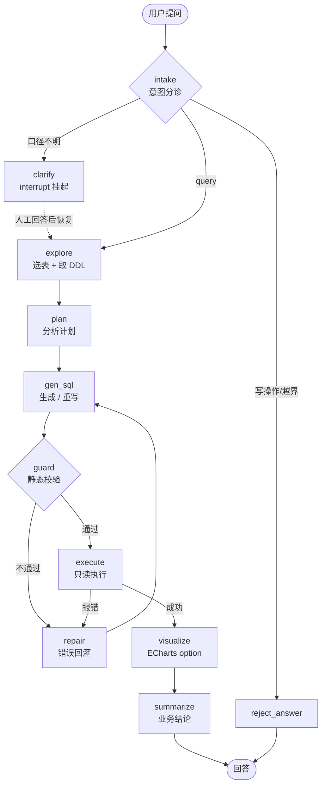

# 架构设计

> 这份文档回答一个问题：**为什么长这样**。面试时被追问设计取舍，答案都在这儿。

## 1. 一句话定位

把「业务用中文问数据」翻译成「可信、可复现、可审计的查询链路」。

不是 RAG，不是让大模型直连数据库跑 SQL，而是**一个带安全边界、错误自愈和量化评测的状态机**。

## 2. 为什么不是「一个 prompt 让模型输出 SQL 然后执行」

三个硬伤，每一个都能在真实环境里出事：

| 硬伤 | 后果 | 本项目的解法 |
|---|---|---|
| 模型会写 `DROP` / `DELETE` | 数据没了 | 三层只读沙箱（静态校验 + 只读连接 + 超时中断） |
| 模型不知道库长什么样 | 字段名瞎猜，报错 | schema 探查 + 业务口径注入 + 错误回灌重试 |
| 一次写不对就完了 | 简单问题都答不出 | 自修复循环（最多 3 次），每次带着真实报错重写 |
| 「跑通了」不等于「对」 | 没法证明效果 | 52 题评测集 + 执行准确率 + A/B 对照 |

## 3. 整体结构



**关键设计**：`gen_sql`（模型）和 `execute`（代码）之间永远隔着一个 `guard`。模型只负责"写"，执行权不在模型手里。

## 4. 节点职责

| 节点 | 干什么 | 调模型 | 失败时 |
|---|---|---|---|
| `intake` | 分诊 query / clarify / reject | 是 | 解析失败按 query 放行（fail-open，避免阻塞正常问题） |
| `clarify` | `interrupt()` 挂起等人答 | 否 | — |
| `explore` | 从表清单挑相关表，只取它们的 DDL | 是 | 解析失败退回全量 DDL |
| `plan` | 2~4 步分析计划（防止直接写 SQL 漏 join/漏过滤） | 是 | 空计划不阻塞 |
| `gen_sql` | 生成 SQL；重试时带上上次 SQL + 报错 | 是 | 解析不出 SQL 记错误 |
| `guard` | 单语句/只读/黑名单/表白名单/自动 LIMIT | 否 | 拦截并转 repair |
| `execute` | 只读连接 + 超时 + 行数上限 | 否 | 报错原文留给 repair |
| `repair` | 只记账（attempt+1） | 否 | — |
| `visualize` | 结果 → ECharts option，数据内联 | 是 | 结构不合法就丢弃图表，不影响结论 |
| `summarize` | 结论；强约束"只能引用结果里的数字" | 是 | — |

## 5. 状态机与路由

路由全部是**纯函数**（`nodes.route_*`），可以脱离图单独测试：

```
route_intake        : clarify → clarify | reject → reject_answer | 其余 → explore
route_after_guard   : 无错误 → execute | 有错误且 attempts < MAX → repair | 否则 → summarize
route_after_execute : 无错误 → visualize | 有错误且 attempts < MAX → repair | 否则 → summarize
```

`attempts` 是循环计数器，挂在 state 上，由 `repair` 递增。这样"最多重试几次"是**状态里的事实**，不是靠 recursion_limit 兜底——后者报错信息对用户毫无意义。

## 6. 三层安全沙箱

```
第 1 层 静态校验   正则 + 词法扫描（跳过字符串字面量）
                   · 必须 SELECT / WITH 开头
                   · 单语句（分号切分时跳过引号内的分号）
                   · 关键字黑名单 INSERT/UPDATE/DELETE/DROP/PRAGMA...
                   · FROM/JOIN 后的表必须在白名单（CTE 名放行）
                   · 没有 LIMIT 自动补
第 2 层 连接层     file:xxx?mode=ro  +  PRAGMA query_only = ON
                   就算静态校验被绕过（比如注释注入），数据库也拒绝写
第 3 层 执行层     set_progress_handler 每 1 万条 VM 指令查一次耗时
                   超时直接 abort；fetchmany(max_rows+1) 截断结果
```

**为什么不用纯正则**：正则分不清 `'delete me'` 这种字符串字面量和关键字。所以先做词法扫描把字面量遮掉再匹配，且真正的兜底在数据库连接层。

## 7. 上下文工程

一次问答的 token 花在哪、怎么省的：

| 手段 | 做法 | 效果 |
|---|---|---|
| 选表 | 先只给表名+行数+列名（catalog），选出相关表后才给完整 DDL | 6 张表时省约 40% DDL 字符 |
| 口径注入 | 只截取 `schema.md` 的「业务口径」一节，不塞整份文档 | 从 8KB 降到约 1.5KB |
| 结果截断 | 推给前端的事件里 rows 只带前 200 行；给模型的只有前 30 行 | 避免 SSE 行过大、prompt 爆掉 |
| 状态瘦身 | `events` 走 reducer 保留，`rows` 只存本次结果 | checkpoint 不无限膨胀 |
| 单轮对话 | checkpointer 让追问只带 `last_sql/last_answer` 摘要，不重放全部历史 | 多轮成本基本不涨 |

## 8. 可恢复性：checkpoint + interrupt

- `SqliteSaver` 落盘到 `data/checkpoints.sqlite`，`thread_id` 是会话主键
- 图在 `clarify` 节点调用 `interrupt(payload)`，执行**挂起而不是失败**，进程重启也不丢
- 恢复用 `Command(resume=value)`，节点会从头重跑，`interrupt()` 直接返回答案（LangGraph 的既定语义，所以节点内不能有不可重入的副作用）
- 追问：同一个 `thread_id` 再 `invoke` 一次，历史状态仍在，`intake` 会读到上一轮摘要
- 每轮开始时 `_initial_state` 只重置本轮字段（attempts/sql/rows...），**保留** `last_sql / last_answer`

## 9. 成本与延迟

单题实测（DeepSeek，2026-09 数据，6 次模型调用）：

| 指标 | 值 |
|---|---|
| 延迟 | P50 7.4 s / P95 9.2 s |
| tokens | 5,030（prompt 4,132 / completion 898） |
| 成本 | ¥0.0154 |

优化方向（也是面试可以主动说的）：
1. intake / plan 可以合并进一次调用（省 1 次往返）
2. `explore` 在表少时可以跳过（已实现：`len(tables) <= 3` 直通）
3. 业务口径固定，适合做 **prompt caching**
4. SQL 生成用 temperature=0，可重放

## 10. 评测

- 52 题，覆盖单表聚合 / 多表 join / 时间序列 / 窗口函数 / 比率 / 综合
- 指标：**执行准确率**（结果集比对，不看 SQL 字面）为主，SQL 合法率、平均尝试次数、成本、P50/P95 延迟为辅
- A/B：`graph`（完整状态机）vs `baseline`（一次性生成、不探查、不修复）
- 详见 `docs/eval-report.md`

## 11. 目录

```
insight/
  config.py     配置与价目（成本可调，不写死）
  types.py      对外契约（StepEvent / RunResult / Usage）
  sandbox.py    三层只读沙箱
  tools.py      数据访问 + schema 目录构建
  prompts.py    全部 prompt；业务口径运行时从 schema.md 读
  nodes.py      10 个节点 + 3 个纯函数路由
  graph.py      图的装配
  service.py    门面：run / stream / resume / get_state
  cli.py        命令行
  db/           造数 + schema 说明
  eval/         数据集、指标、baseline、跑分
web/            FastAPI + SSE + 单页前端
tests/          沙箱单测 + 整图离线测试（假 LLM，不花钱）
docs/           架构、评测报告、面试手册
```

## 12. 已知限制（主动说出来比被问出来好）

1. 单库单方言（SQLite），没做多数据源路由
2. 没有语义层/指标层，口径靠 prompt + 文档约束，不是强校验
3. `visualize` 是让模型直接出 option，复杂图表（多轴、组合图）容易退化成柱状图
4. 并发用的是线程 + 全局图单例，够演示不够生产；生产要上队列和限流
5. 没有做 PII 脱敏和审计日志
